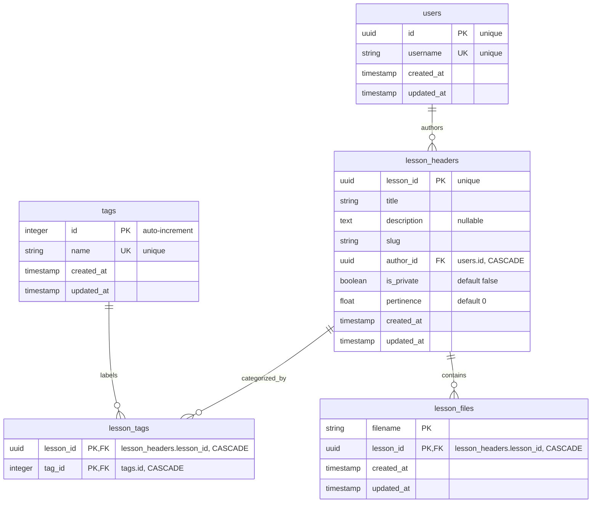

# Database Schema

The Lesson Service uses **PostgreSQL** via the AdonisJS Lucid ORM. The schema is defined by
migrations in `Lesson-service/database/migrations/`; `Lesson-service/database/schema.ts` is
auto-generated from those migrations and is the source of truth for model types.

The field dictionary below uses the actual database column names (`snake_case`). Lucid exposes the same columns as camelCase properties in `schema.ts` (e.g. `created_at` → `createdAt`,
`updated_at` → `updatedAt`, `is_private` → `isPrivate`, `tag_id` → `tagId`).

> **Note:** `Lesson-service/database/schema/pg-schema.sql` is currently empty. Do not edit it by
> hand; run `node ace migration:run` to regenerate `schema.ts` after migration changes.

## ER diagram

## Field dictionary

### `users`

Local shadow table that maps an auth-service user UUID to a display username. It is backfilled from the User Service when a new authenticated user creates their first lesson (see
[`verify_token_middleware.ts:19-31`](../Lesson-service/app/middleware/verify_token_middleware.ts)).

| Column | Type | Nullable | Default | Notes |
|--------|------|----------|---------|-------|
| `id` | `uuid` | No | — | Primary key; matches the auth-service user ID. |
| `username` | `string` | No | — | Unique display name from the User Service. |
| `created_at` | `timestamp` | Yes | — | Auto-created by Lucid. |
| `updated_at` | `timestamp` | Yes | — | Auto-updated by Lucid. |

Migration: [`Lesson-service/database/migrations/1779357505614_create_users_table.ts`](../Lesson-service/database/migrations/1779357505614_create_users_table.ts)

### `lesson_headers`

Core lesson metadata. The actual lesson content is not stored here; only the header, slug, privacy
flag, and pertinence score live in this table.

| Column        | Type        | Nullable | Default | Notes                                                                                                                                           |
| ------------- | ----------- | -------- | ------- | ----------------------------------------------------------------------------------------------------------------------------------------------- |
| `lesson_id`   | `uuid`      | No       | —       | Primary key; assigned in the model hook `assignUuid` before create ([`lesson_header.ts:30-33`](../Lesson-service/app/models/lesson_header.ts)). |
| `title`       | `string`    | No       | —       | Lesson title.                                                                                                                                   |
| `description` | `text`      | Yes      | —       | Optional long-form description.                                                                                                                 |
| `slug`        | `string`    | No       | —       | Derived from `title` (lowercase, spaces → `-`, non-alphanumeric stripped). Unique per author.                                                   |
| `author_id`   | `uuid`      | No       | —       | Foreign key to `users.id`, `ON DELETE CASCADE`.                                                                                                 |
| `is_private`  | `boolean`   | No       | `false` | Visibility flag. Public lessons are searchable by anyone; private lessons are visible only to the author.                                       |
| `pertinence`  | `float`     | No       | `0`     | Relevance score for future ranking.                                                                                                             |
| `created_at`  | `timestamp` | Yes      | —       | Auto-created.                                                                                                                                   |
| `updated_at`  | `timestamp` | Yes      | —       | Auto-updated.                                                                                                                                   |

Migration: [`Lesson-service/database/migrations/1779357505615_create_lesson_headers_table.ts`](../Lesson-service/database/migrations/1779357505615_create_lesson_headers_table.ts)

### `tags`

Global tag registry. Populated at startup from `lesson_tags.csv` via the base seeder.

| Column | Type | Nullable | Default | Notes |
|--------|------|----------|---------|-------|
| `id` | `integer` | No | auto-increment | Primary key. |
| `name` | `string` | No | — | Unique tag name. |
| `created_at` | `timestamp` | Yes | — | Auto-created. |
| `updated_at` | `timestamp` | Yes | — | Auto-updated. |

Migration: [`Lesson-service/database/migrations/1779357505548_create_tags_table.ts`](../Lesson-service/database/migrations/1779357505548_create_tags_table.ts)

### `lesson_tags`

Many-to-many pivot between lessons and tags.

| Column | Type | Nullable | Default | Notes |
|--------|------|----------|---------|-------|
| `lesson_id` | `uuid` | No | — | Composite PK, FK → `lesson_headers.lesson_id`, `ON DELETE CASCADE`. |
| `tag_id` | `integer` | No | — | Composite PK, FK → `tags.id`, `ON DELETE CASCADE`. |

Migration: [`Lesson-service/database/migrations/1779357505749_create_lesson_tags_table.ts`](../Lesson-service/database/migrations/1779357505749_create_lesson_tags_table.ts)

### `lesson_files`

Mapping between a lesson and filenames stored in the external File Service. The composite primary key prevents the same file from being attached twice to the same lesson.

| Column | Type | Nullable | Default | Notes |
|--------|------|----------|---------|-------|
| `filename` | `string` | No | — | Composite PK; opaque filename in the File Service. |
| `lesson_id` | `uuid` | No | — | Composite PK, FK → `lesson_headers.lesson_id`, `ON DELETE CASCADE`. |
| `created_at` | `timestamp` | Yes | — | Auto-created. |
| `updated_at` | `timestamp` | Yes | — | Auto-updated. |

Migration: [`Lesson-service/database/migrations/1787307409032_create_lesson_files_table.ts`](../Lesson-service/database/migrations/1787307409032_create_lesson_files_table.ts)

## Relations (Lucid models)

- `LessonHeader` → `User` via `belongsTo('authorId')` ([`lesson_header.ts:24-28`](../Lesson-service/app/models/lesson_header.ts)).
- `LessonHeader` → `Tag` via `manyToMany('lesson_tags')` ([`lesson_header.ts:9-16`](../Lesson-service/app/models/lesson_header.ts)).
- `LessonHeader` → `LessonFile` via `hasMany('lessonId')` ([`lesson_header.ts:18-22`](../Lesson-service/app/models/lesson_header.ts)).
- `LessonFile` → `LessonHeader` via `belongsTo('lessonId')` ([`lesson_file.ts:7-11`](../Lesson-service/app/models/lesson_file.ts)).
- `Tag` → `LessonHeader` via inverse `manyToMany` ([`tag.ts:7-14`](../Lesson-service/app/models/tag.ts)).

## Privacy rules

Access helpers in [`app/service/lesson.ts:10-19`](../Lesson-service/app/service/lesson.ts) enforce:

- A public lesson (`is_private = false`) is visible to everyone.
- A private lesson is visible only to its `author_id`.
- The search endpoint currently restricts results to public lessons only
  ([`searches_controller.ts:14`](../Lesson-service/app/controllers/searches_controller.ts)); a TODO
  notes future support for authors viewing their own private lessons in search.

## Drift from the old root README

The root [`README.md`](../README.md) documents an older schema: a standalone `files` table with
`file_path`, a `users` table with `full_name`/`email`/`password`, and an `access_tokens` table. Those
do not exist in the current migrations. This document reflects the schema actually created by the
migrations above.
